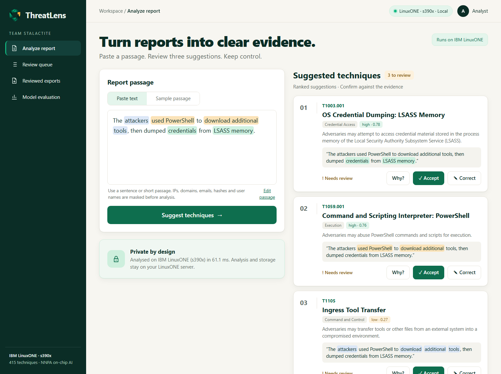
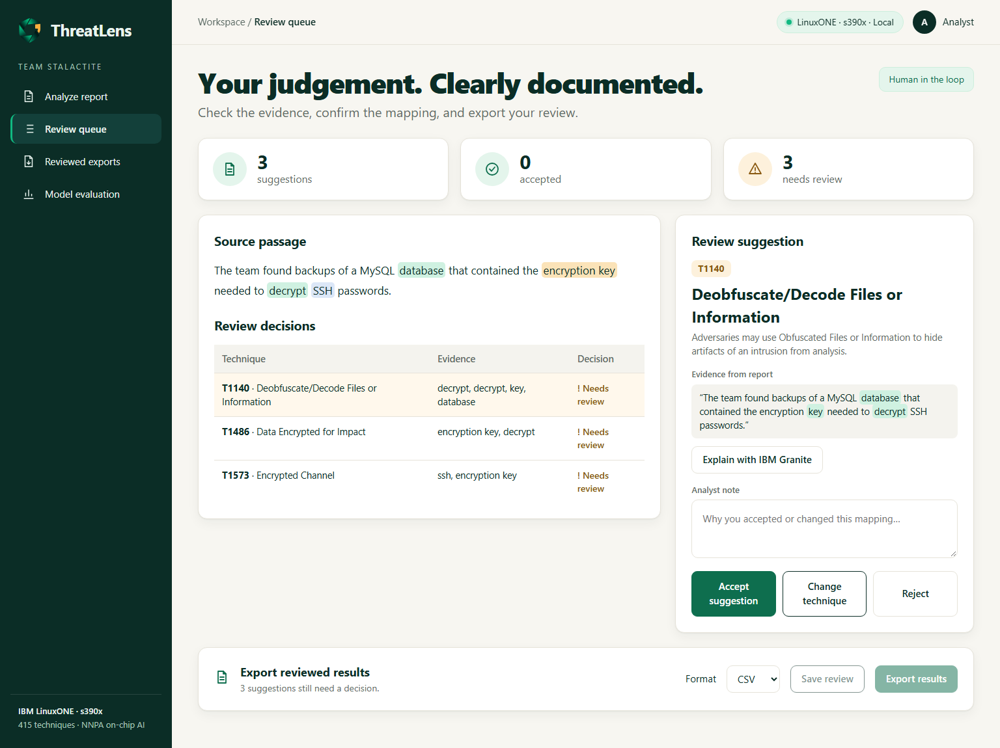
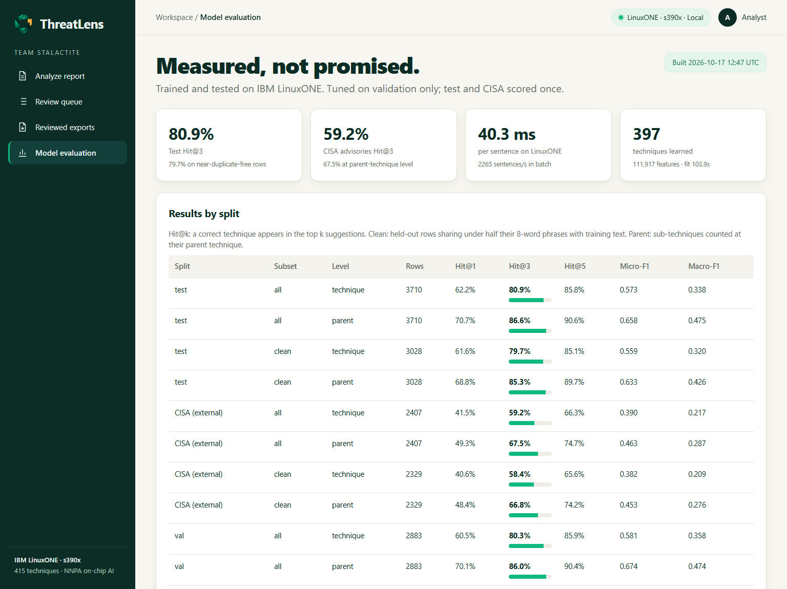
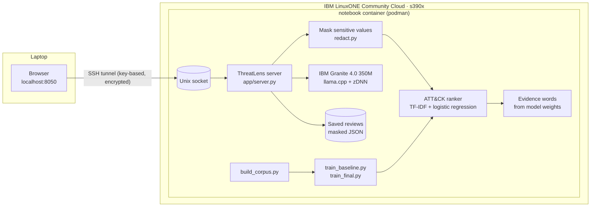

# ThreatLens: Clarity without exposure

**Private AI that maps cyber threat reports to MITRE ATT&CK, running entirely on IBM LinuxONE.**

Team **Stalactite** · IBM Z Datathon 2026 · Theme 2: **AI Secured: Innovation Without Exposure** (Powerful AI. Protected Data.)

**Team Stalactite, Manipal Academy of Higher Education, Dubai Campus:** Muhammad Rizwan, Shaurav Divyesh Vora,
Shabnam Haseena, Amardev Anishkumar, Disha Gowda, Rijun Jude Kaniyampurath

**Submission pack:** [pitch deck (PDF)](submission/Stalactite_IBM%20Z%20Datathon%202026%20Project.pdf) ·
[architecture diagram (PDF)](submission/ThreatLens_Architecture.pdf) · [all submission files](submission/)



## The problem

Security teams read long threat reports and must translate each described behaviour into the standard
MITRE ATT&CK vocabulary (for example "dumped credentials from LSASS memory" → T1003.001). This mapping
drives detection rules and defensive gap analysis, but it is slow, needs scarce expertise, and the
reports themselves are sensitive: they name the victim's systems, accounts and weaknesses. Pasting them
into an external AI service exposes exactly what an attacker would want.

**Who benefits:** analysts in security operations centres (SOCs), incident responders and
threat-intelligence teams, especially in under-resourced public bodies, hospitals, schools and NGOs, and
cybersecurity students learning ATT&CK.

## What ThreatLens does

1. **Paste a passage** from a threat report.
2. **Sensitive values are masked first**: IP addresses, domains, URLs, emails, file hashes and usernames in file paths are replaced with `[IP]`, `[DOMAIN]` and so on. Only masked text is ever stored or exported.
3. **Three ranked ATT&CK techniques** are suggested in about 60 ms, each with the sentence that supports it and the words that drove the score. These come from the model's own weights, not from generated text.
4. **IBM Granite explains** a suggestion on request, running locally on LinuxONE through llama.cpp.
5. **The analyst decides**: accept, change technique (the next-best suggestions are offered first), or reject, and adds a note.
6. **Export** the reviewed mapping as CSV or JSON.

A human stays responsible for every final mapping. ThreatLens analyses written reports; it does not
monitor networks, detect live attacks or block anything.

| Review queue | Model evaluation |
|---|---|
|  |  |

## How it uses IBM Z / LinuxONE

Everything runs in the `notebook` container on our IBM LinuxONE Community Cloud server (s390x, 3 CPUs, 8 GB):

| Step | On LinuxONE |
|---|---|
| Data pipeline | `scripts/build_corpus.py` parses 4 datasets and 82 CISA PDF advisories into a 24,872-sentence corpus in about 50 s |
| Training | `scripts/train_baseline.py` tries 3 candidate settings in turn, each fitted in parallel on all 3 CPUs; the final model trains in 147 s |
| Predictive AI | TF-IDF + one-vs-rest logistic regression (scikit-learn), 415 techniques, ~60 ms per passage |
| Generative AI | IBM Granite 4.0 H 350M via `llama-cpp-python`, built with the IBM zDNN backend (the NNPA on-chip AI accelerator is present on this server) |
| Security | The app listens on a **Unix socket inside the container**, so it opens no additional TCP listener. Users reach it only through an authenticated, encrypted SSH tunnel. No report content is sent to external AI services. |
| Evidence | `notebooks/ThreatLens_LinuxONE_demo.ipynb` runs the whole flow on s390x with saved outputs |


Simplified view:



## Results (measured on LinuxONE)

The model was tuned on the validation split only. Test and the CISA external set were scored once.
**Hit@3** is the share of sentences where a correct technique appears in the top 3 suggestions.

| Evaluation set | Rows | Hit@1 | **Hit@3** | Hit@5 | Hit@3 (parent technique) |
|---|---|---|---|---|---|
| Test (same sources as training) | 3,710 | 62.2% | **80.9%** | 85.8% | 86.6% |
| Test, low-overlap subset | 3,028 | 61.6% | **79.7%** | 85.1% | 85.3% |
| CISA advisories (new source, never trained on) | 2,407 | 41.5% | **59.2%** | 66.3% | 67.5% |
| CISA, low-overlap subset | 2,329 | 40.6% | **58.4%** | 65.6% | 66.8% |

- Performance changes little on the low-overlap subset. The filter reduces near-duplicates; it cannot rule out all memorisation or leakage.
- CISA advisories are harder: a different writing style, and 7.5% of their rows use techniques that never appear in training. This is why ThreatLens offers a ranked shortlist for a human to confirm rather than tagging automatically.
- Speed (baseline model, train only): 40 ms per sentence, about 2,265 sentences per second in batch, on 3 LinuxONE CPUs. The served model (train + val, 415 techniques) answers the demo passage in about 50–70 ms.
- Test Hit@3 by source: TRAM 89.9%, MITRE procedures 88.3%, Expert 76.3%, AnnoCTR 67.5% (77.8% at parent level, because AnnoCTR labels only parent techniques).

Full tables: `outputs/metrics/baseline_report.md` on the server, and the **Model evaluation** page in the app.

## Data

| Source | Use | Licence |
|---|---|---|
| [AnnoCTR](https://github.com/boschresearch/anno-ctr-lrec-coling-2024) (Lange et al., LREC-COLING 2024) | train / val / test (its official report-level splits) | CC BY-SA 4.0 |
| [Security TTP Mapping](https://github.com/tumeteor/mitre-ttp-mapping): TRAM, Procedures, Derived Procedures, Expert (Nguyen et al., EACL 2024) | train / val / test (authors' splits) | CC BY 4.0 per README text (badge says CC BY-NC-SA 4.0) |
| [CISA cybersecurity advisories](https://www.cisa.gov/news-events/cybersecurity-advisories) (82 advisories, 2020–2025) | external test only, never trained on | US Government work |
| [MITRE ATT&CK Enterprise](https://github.com/mitre-attack/attack-stix-data) STIX bundle | label reference: names, descriptions, tactics, revoked/deprecated IDs | [ATT&CK Terms of Use](https://attack.mitre.org/resources/legal-and-branding/terms-of-use/) |

**Corpus pipeline** (`scripts/build_corpus.py`, `src/threatlens/`):
- Labels from older ATT&CK versions are remapped: revoked IDs follow MITRE's "revoked-by" links, and deprecated or unknown IDs are dropped.
- **Answer leakage is removed from the input text:** technique and tactic IDs, "(Name [T1234])" tags, markdown table cells holding the ID or name, MITRE definitions pasted into CISA tables, headings and figure captions.
- Exact duplicates across datasets are merged into their strictest split, so no test sentence appears in training.
- Each held-out row gets a near-duplicate score (`train_ngram_overlap`) and an `eval_clean` flag.
- Output: `data/processed/` (CSV per split plus `ThreatLens_corpus.xlsx`), with every change logged in `label_changes.csv` and `dropped.csv`.

Raw data and models are not committed; `data/SOURCES.md` lists where each file came from.

## Run it

On the LinuxONE server (inside the existing `notebook` container):

```bash
python scripts/build_corpus.py      # ~1 min: data/processed/
python scripts/train_baseline.py    # ~6 min: tuning + evaluation report
python scripts/train_final.py       # ~3 min: the model the app serves
python app/server.py                # serves on run/threatlens.sock
```

From a laptop (no ports are opened on the server):

```bash
ssh -N -L 8050:/home/linux1/shared/threatlens/run/threatlens.sock -i <your key> linux1@<server>
# then open http://localhost:8050   (demo deep link: http://localhost:8050/#/analyze?sample=1)
```

`tools/app.sh start|stop|status|logs` manages the app over SSH. `tools/push_bulk.sh` uploads data folders safely, never overwriting existing files.

## Repository layout

```
app/server.py            web server + JSON API (standard library only)
app/static/              UI (HTML/CSS/JS, no external requests)
src/threatlens/          attack.py (ATT&CK reference), sources.py (loaders), leakage.py, textclean.py,
                         model.py, metrics.py, explain.py (evidence words), redact.py, granite.py, xlsx.py
scripts/                 build_corpus.py, train_baseline.py, train_final.py
notebooks/               ThreatLens_LinuxONE_demo.ipynb (executed on LinuxONE)
data/SOURCES.md          provenance and licences; data/raw/cisa/manifest.csv
design/                  logo and UI concepts
docs/screenshots/        app screenshots
```

## Open-source resources used

- [Python 3.12](https://www.python.org/), [scikit-learn](https://scikit-learn.org/), [NumPy](https://numpy.org/), [SciPy](https://scipy.org/), [pandas](https://pandas.pydata.org/), [joblib](https://joblib.readthedocs.io/)
- [pypdf](https://github.com/py-pdf/pypdf) for reading CISA PDFs
- [llama.cpp](https://github.com/ggml-org/llama.cpp) and [llama-cpp-python](https://github.com/abetlen/llama-cpp-python), with the [IBM zDNN](https://github.com/IBM/zDNN) backend
- [IBM Granite 4.0 H 350M](https://huggingface.co/ibm-granite) language model, as provided in the IBM LinuxONE Jupyter lab image
- [JupyterLab](https://jupyter.org/) and [nbconvert](https://nbconvert.readthedocs.io/), [Podman](https://podman.io/), [IBM LinuxONE Community Cloud](https://github.com/linuxone-community-cloud/technical-resources)
- Datasets: AnnoCTR, Security TTP Mapping (TRAM, Procedure+, Expert), CISA advisories and MITRE ATT&CK, all linked in the Data table above

## Originality and AI-assistance disclosure

- **Prior work.** Our team previously published a paper on mapping *industrial control system* (ICS) threat reports to MITRE ATT&CK for ICS (ASET 2026). ThreatLens is a new tool for the *Enterprise* matrix, with different data, a different label space and new code. All ThreatLens code was written during the datathon window (17–18 October 2026), and no code, models, data or results from the paper are reused.
- **AI assistance.** We used an AI coding assistant (Anthropic's Claude) to help write and review code and documentation. All design decisions, data choices and results were checked by the team, and every reported number was produced by running the code on LinuxONE.
- Server-access helper scripts prepared during the pre-event setup session are not part of this submission.

## Limitations

- Sentence-level suggestions: very long reports should be pasted in sections.
- 415 of the ~700 Enterprise techniques have enough training examples; rarer techniques can only be reached through "Change technique".
- Granite 4.0 H 350M is a small base model, so its explanations are drafts for the analyst to verify.
- Redaction is pattern-based. It covers common indicators but is not a guarantee: review exports before sharing them.
